<!-- GENERATED by `python -m src.docs` from templates/README.md.tpl and the saved results of the current run (config fingerprint 4d55652eba8e68384e84f9b45973034903f7c4fb1abdab57660c062c084d99c4). Edit the template, not this file. -->
<div align="center">

# Signal vs Continuum Classification with Belle II Event-Shape Features

**IDC409 - Introduction to Data Science and AI  |  Project 1  |  IISER Mohali**

    

</div>

## Contributors

| Name | Roll number | Institution |
|---|---|---|
| **Daman Kumar** | MS23031 | IISER Mohali |
| **Pulkit** | MS23099 | IISER Mohali |

---

## Contents

1. [Overview](#1-overview)
2. [Data and label meaning](#2-data-and-label-meaning)
3. [Pipeline](#3-pipeline)
4. [Exploratory analysis](#4-exploratory-analysis)
5. [Models and evaluation protocol](#5-models-and-evaluation-protocol)
6. [Results](#6-results)
7. [Feature reduction](#7-feature-reduction)
8. [Why is performance near chance? (checked)](#8-why-is-performance-near-chance-checked)
9. [Demo app](#9-demo-app)
10. [Reproduce everything](#10-reproduce-everything)
11. [Repository layout](#11-repository-layout)
12. [Verification](#12-verification-what-was-and-was-not-tested)
13. [Limitations](#13-limitations)

---

## 1. Overview

At the Belle II experiment, electrons and positrons collide. Some events are **signal** (B-meson pairs). Many others are **continuum background** (ordinary quark pairs). The two kinds tend to have different *shapes*: signal events are rounder, continuum events are often two narrow jets. **Continuum suppression** means using shape variables to throw away as much background as possible while keeping most of the signal.

**Question.** How well can 59 Belle II event-shape numbers separate **signal** (`type = +1`) from **continuum** (`type = 0` or `-1`), which classifier is best, and how much can the feature set be reduced?

### At a glance

| | |
|---|---|
| Events in the file | 70,606 (59 features each) |
| Events used (signal + continuum) | 35,765  =  35,303 signal + 462 continuum |
| Signal share | 98.7%  (an "always signal" rule is 0.987 accurate but removes **no** background) |
| Held-out test set | 5,297 signal and only **69 continuum** events |
| Models | 4 learned (logistic regression, decision tree, random forest, gradient boosting) + 2 baselines |
| Selected model (validation) | Random forest, test ROC-AUC **0.505** (95% interval 0.434-0.573) |
| At the chosen cut | keeps **93.3%** of true signal, removes **5.8%** of true continuum |

> **Honest headline.** The validation-selected model (Random forest) has test ROC-AUC 0.505 (close to chance); its 95% interval 0.434-0.573 includes 0.5 (chance). The highest test AUC among full-feature models is 0.567 (Single-feature cut, interval 0.504-0.630, which excludes 0.5 only barely; it was not the validation choice). Counting every feature-set variant (full, correlation-filtered, reduced), the highest test AUC is 0.568 (Decision tree, reduced features, interval 0.521-0.614); it too was not chosen on validation data. With 15 model / feature-set combinations scored on the same 69 continuum test events, one interval that excludes 0.5 is expected by chance alone and is not evidence of real separation. Among full-feature learned classifiers the AUC interval includes 0.5 for: Logistic regression, Decision tree, Random forest, Gradient boosting. On the instructor-provided mapping, at the validation-chosen operating point (signal efficiency floor 90%) the validation-selected model keeps 93.3% of true signal and rejects 5.8% of true continuum on the test set (only 69 continuum events; 95% exact interval 1.6%, 14.2%). For comparison, a score with no discrimination would reject about 6.7% at this efficiency.

**Flag for the instructor.** Under the instructor-provided mapping the type-0 events (the only continuum rows in the file; 0 type -1 rows exist) are, in these 59 features, nearly the same as the signal events: the best single feature (`thrustOm`) reaches an AUC of only 0.562 on the training rows, and no model separates the classes well. Physically, continuum (light-quark/charm) events are expected to be more jet-like (higher R2 and thrust, cosTBTO peaked at 1) than B-pair signal events; the type-0 events show the *signal-like* pattern instead (figure 3 and 4). This report does not change the mapping, but the data do not show the separation that a signal-versus-continuum task normally has, so it would be worth confirming with the instructor that code 0 really is continuum and that no type -1 data were meant to be included.

---

## 2. Data and label meaning

- **Dataset:** the Belle II simulated sample provided for the course, `data/raw/data_hep.csv` (70,606 rows, 59 numeric features, an unnamed index-like column and `type`). SHA-256 `fadaeb5a20a7809658f760eb4b49feef3ee89c7823d1a215356d40e20266cf67`.
- **Type counts in the file:** 0: 462, 1: 35,303, 2: 23,333, 3: 8,172, 4: 1,879, 5: 1,457.
- **Label meaning:** from the instructor's clarification, relayed by the student: `type +1` = signal, `type 0` or `-1` = continuum, codes 2-5 = other decays. This cannot be verified from the data files.
- **What the file really contains:** 35,303 signal, 462 continuum (all type 0) and **0 type -1 rows**. Nothing was invented.
- **Exclusion (our analysis decision, not an instructor instruction):** other decays (codes 2-5, type 2: 23,333; type 3: 8,172; type 4: 1,879; type 5: 1,457) are neither signal nor continuum, so they are left out of the experiment.
- **Index column:** the unnamed first column repeats values and its range depends on the label. Its origin is undocumented, so it is never used as a model input (leakage risk).
- **Data note:** the CSV is **not** stored in this repository (80 MB; permission to redistribute is not established). Place your own copy at `data/raw/data_hep.csv`. Excluded rows and original row identifiers are recorded in `artifacts/metrics/split_assignments.csv`.

<p align="center">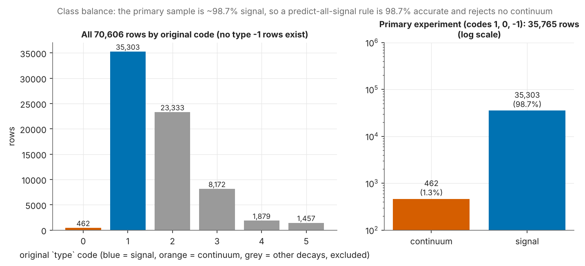</p>
<p align="center"><em>Figure 1. Counts per type code (blue = signal, orange = continuum, grey = other decays, excluded). The experiment is about 98.7% signal, so plain accuracy is misleading.</em></p>

---

## 3. Pipeline

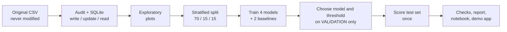

Key rules: validation and test data are never resampled or weighted; class weights and scalers are fitted on training rows only; the threshold is frozen before the test set is scored; excluded types never enter any split.

---

## 4. Exploratory analysis

<p align="center">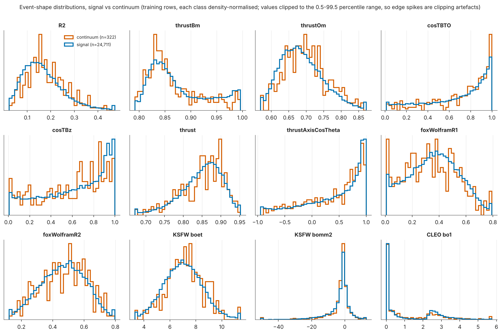</p>
<p align="center"><em>Figure 2. Twelve key event-shape features, signal (blue) vs continuum (orange), training rows. The curves overlap almost everywhere.</em></p>

<p align="center">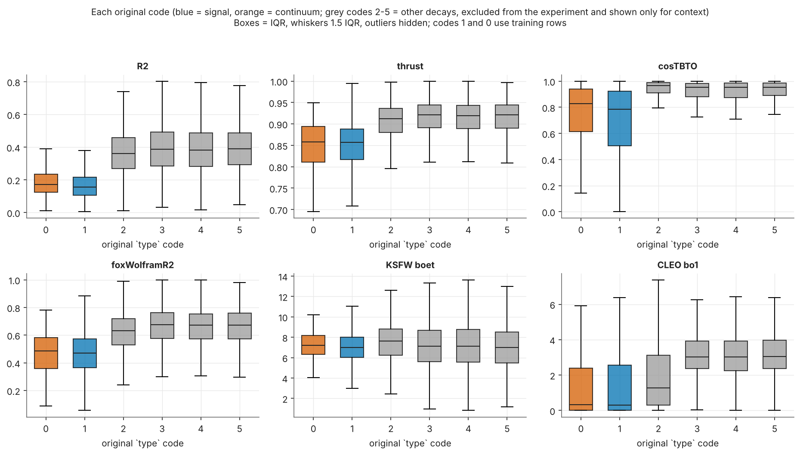</p>
<p align="center"><em>Figure 3. The same kind of features for every original type code. Grey boxes (other decays) look jet-like; the type-0 "continuum" rows look like signal.</em></p>

<table>
<tr>
<td width="50%">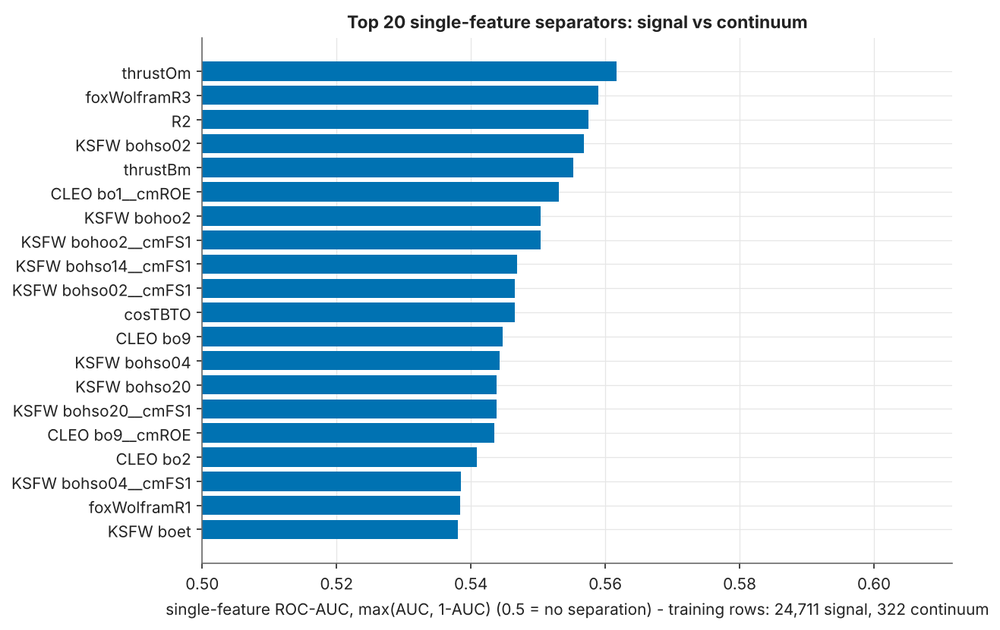<br><em>Figure 4. Best single features (0.5 = no separation).</em></td>
<td width="50%">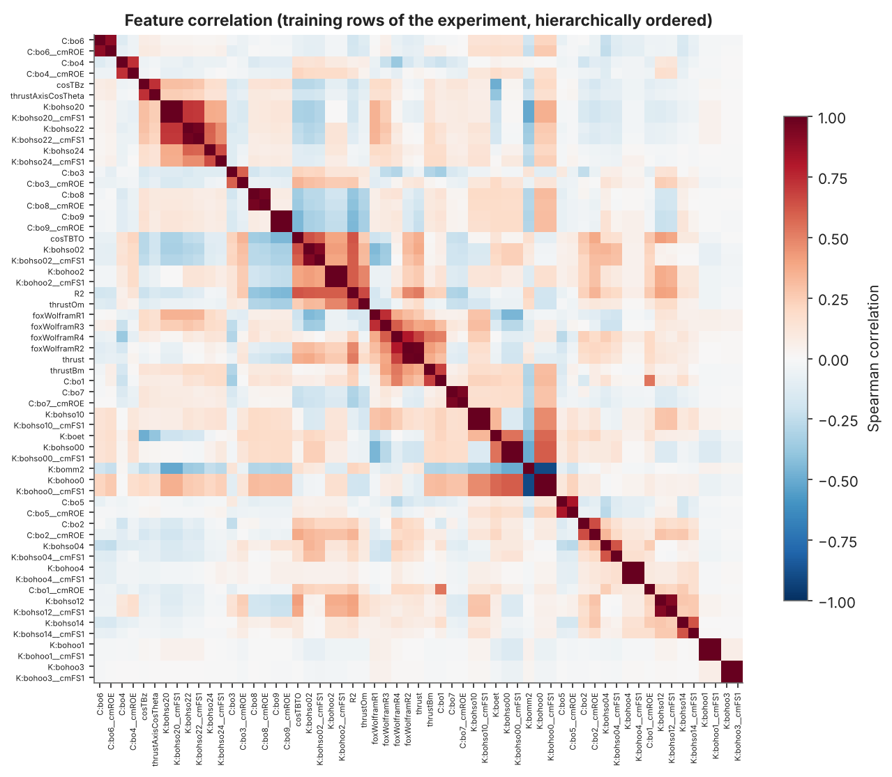<br><em>Figure 5. Many features are near-copies of each other (17 pairs with |r| &ge; 0.9).</em></td>
</tr>
</table>

Data health: no missing or infinite values, no duplicate or conflicting rows, no odd placeholder values. Exact zeros occur only in CLEO-cone features and are kept (they mean "no energy in that cone").

---

## 5. Models and evaluation protocol

| Model | Idea in simple words | Features used |
|---|---|---|
| Majority class (baseline) | always answer "signal" | 0 |
| Single-feature cut (baseline) | one number, one cut (`thrustOm`, picked from 59) | 1 |
| Logistic regression | one straight dividing line through the feature space | 59 |
| Decision tree | a chain of yes/no questions | 59 |
| Random forest | many trees voting together | 59 |
| Gradient boosting | trees added one by one, each fixing the last one's mistakes | 59 |

- **Split:** stratified 70 / 15 / 15 (seed 42): 24,711 / 322 train, 5,295 / 71 validation, 5,297 / 69 test (signal / continuum).
- **Class weighting:** compared fairly on validation data for every learned model (training labels only).
- **Operating point:** the score cut is chosen on the **validation** pile to remove as much continuum as possible while keeping at least 90% of signal (the 90% is our analysis choice, not an instructor requirement). It is frozen, then applied once to the test set.
- **Metrics:** signal efficiency (share of true signal kept), continuum rejection (share of true continuum removed), continuum acceptance (= 1 - rejection), accuracy, precision, recall, F1, balanced accuracy, macro-F1 and ROC-AUC (which does not depend on the cut).
- **Uncertainty:** exact (Clopper-Pearson) intervals for efficiency and rejection with their real denominators; stratified bootstrap for AUC; five different splits as an extra check.

<p align="center">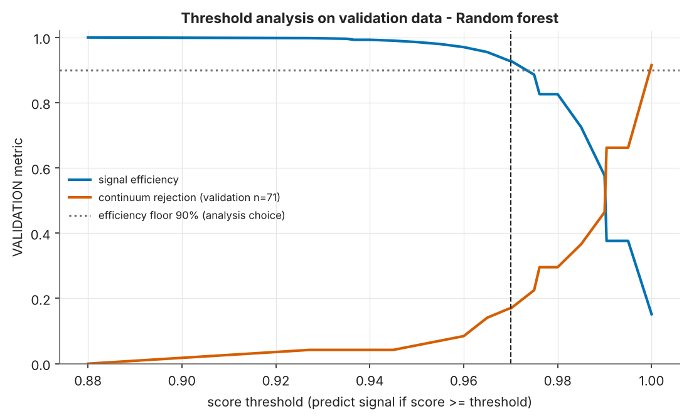</p>
<p align="center"><em>Figure 6. Validation curves used to pick the cut: signal efficiency (blue) and continuum rejection (orange) as the cut moves.</em></p>

---

## 6. Results

Held-out **test set**: 5,297 signal and **69 continuum** events.

**Table A - required metrics at the validation-selected operating point** (ROC-AUC does not depend on the threshold):

| Model | Accuracy | Precision (signal) | Recall (signal) | F1 (signal) | ROC-AUC [95% CI] | Features used | Threshold | Final fit (s) |
|---|---|---|---|---|---|---|---|---|
| Majority class | 0.987 | 0.987 | 1.0 | 0.994 | 0.500 [0.500, 0.500] | 0 | 1.0 | 0.0 |
| Single-feature cut | 0.899 | 0.988 | 0.909 | 0.947 | 0.567 [0.504, 0.630] | 1 (thrustOm; 59 examined) | 0.001 | 0.5 |
| Logistic regression | 0.894 | 0.987 | 0.904 | 0.944 | 0.530 [0.460, 0.598] | 59 | 0.979 | 0.1 |
| Decision tree | 0.923 | 0.987 | 0.934 | 0.96 | 0.522 [0.459, 0.588] | 59 | 0.254 | 1.2 |
| Random forest | 0.922 | 0.987 | 0.933 | 0.959 | 0.505 [0.434, 0.573] | 59 | 0.97 | 14.1 |
| Gradient boosting (HistGB) | 0.897 | 0.988 | 0.907 | 0.946 | 0.545 [0.475, 0.617] | 59 | 0.994 | 11.7 |


**Table B - signal efficiency and continuum rejection** (exact 95% intervals; the continuum denominator is 69):

| Model | Signal efficiency [95% exact CI], n=5,297 | Continuum rejection [95% exact CI], n=69 | Continuum acceptance | Balanced accuracy | Macro-F1 |
|---|---|---|---|---|---|
| Majority class | 100.0% [99.9%, 100.0%] | 0.0% [0.0%, 5.2%] | 100.0% | 0.5 | 0.497 |
| Single-feature cut | 90.9% [90.1%, 91.6%] | 13.0% [6.1%, 23.3%] | 87.0% | 0.52 | 0.489 |
| Logistic regression | 90.4% [89.5%, 91.2%] | 11.6% [5.1%, 21.6%] | 88.4% | 0.51 | 0.485 |
| Decision tree | 93.4% [92.7%, 94.1%] | 5.8% [1.6%, 14.2%] | 94.2% | 0.496 | 0.489 |
| Random forest | 93.3% [92.6%, 94.0%] | 5.8% [1.6%, 14.2%] | 94.2% | 0.495 | 0.489 |
| Gradient boosting (HistGB) | 90.7% [89.9%, 91.5%] | 13.0% [6.1%, 23.3%] | 87.0% | 0.519 | 0.489 |


At the plain cut 0.5, Random forest gives accuracy 0.987, precision 0.987, recall 1.000, F1 0.994. More tables (cut 0.5, per-class, class weighting, full vs reduced) are in `artifacts/metrics/results_tables.md` and `reports/report.md`. With the paired stratified bootstrap, the AUC difference between the selected model and the following models has an interval that includes zero, so no clear difference is established on this test set: Single-feature cut, Logistic regression, Decision tree, Gradient boosting.

<p align="center">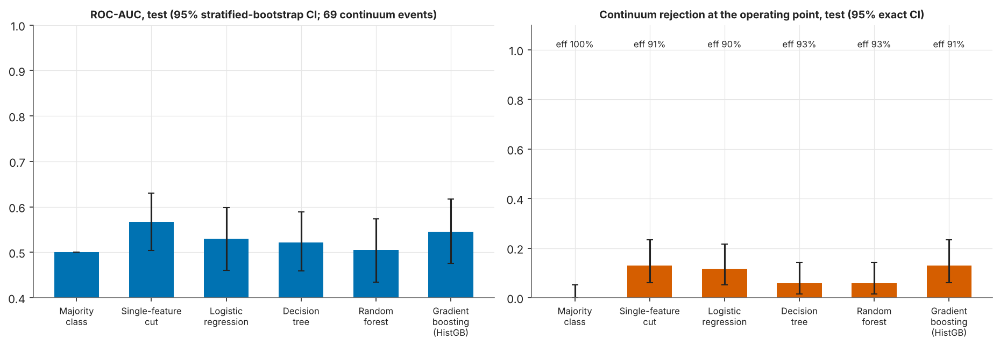</p>
<p align="center"><em>Figure 7. ROC-AUC with 95% intervals and continuum rejection at the chosen cut, with exact intervals.</em></p>

<p align="center"></p>
<p align="center"><em>Figure 8. ROC and precision-recall curves, with signal and with continuum as the positive class (reversed score). All curves hug the coin-flip diagonal.</em></p>

<p align="center"></p>
<p align="center"><em>Figure 9. Confusion matrices on the test set: plain cut 0.5 (top) and the chosen cut (bottom). Rows are the true classes, counts are shown.</em></p>

<p align="center">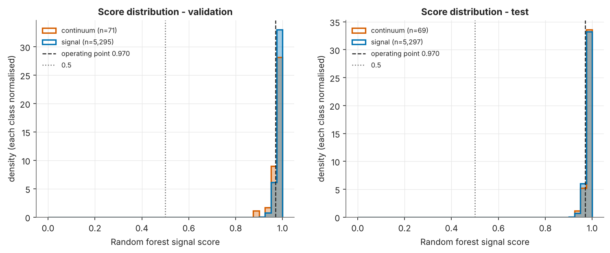</p>
<p align="center"><em>Figure 10. Scores of the selected model for signal and continuum: the two groups overlap almost completely.</em></p>

"Signal-like" in all plots means only "score above the cut", not a known signal label.

---

## 7. Feature reduction

Method: (1) drop one of each highly correlated pair (|Spearman| &ge; 0.95): 59 to 47 features; (2) rank the rest by permutation importance on validation data; (3) keep the smallest set that works about as well: **3 features**. All learned models were re-tuned and evaluated with the same rules.

| Model | Feature set | Features | ROC-AUC | AUC diff vs full [95% paired CI] | Signal eff. | Continuum rej. (n=69) | Balanced acc. |
|---|---|---|---|---|---|---|---|
| Logistic regression | full | 59 | 0.53 | - | 90.4% | 11.6% | 0.51 |
| Logistic regression | corr_filtered | 47 | 0.526 | -0.0030 [-0.0201, +0.0140] | 90.0% | 10.1% | 0.501 |
| Logistic regression | reduced | 3 | 0.565 | +0.0360 [-0.0307, +0.1029] | 89.6% | 15.9% | 0.528 |
| Decision tree | full | 59 | 0.522 | - | 93.4% | 5.8% | 0.496 |
| Decision tree | corr_filtered | 47 | 0.513 | -0.0084 [-0.0737, +0.0500] | 96.0% | 1.4% | 0.487 |
| Decision tree | reduced | 3 | 0.568 | +0.0444 [-0.0308, +0.1240] | 90.4% | 17.4% | 0.539 |
| Random forest | full | 59 | 0.505 | - | 93.3% | 5.8% | 0.495 |
| Random forest | corr_filtered | 47 | 0.497 | -0.0072 [-0.0872, +0.0683] | 93.6% | 4.3% | 0.49 |
| Random forest | reduced | 3 | 0.548 | +0.0428 [-0.0275, +0.1121] | 91.1% | 7.2% | 0.491 |
| Gradient boosting (HistGB) | full | 59 | 0.545 | - | 90.7% | 13.0% | 0.519 |
| Gradient boosting (HistGB) | corr_filtered | 47 | 0.537 | -0.0094 [-0.0699, +0.0484] | 91.4% | 10.1% | 0.508 |
| Gradient boosting (HistGB) | reduced | 3 | 0.553 | +0.0063 [-0.0759, +0.0884] | 90.7% | 7.2% | 0.49 |


<p align="center">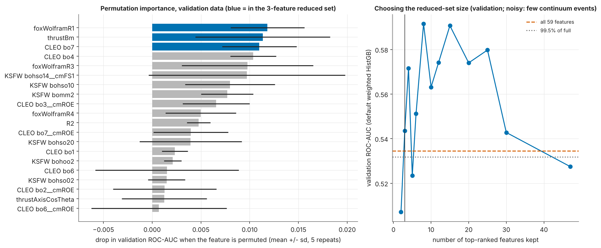</p>
<p align="center"><em>Figure 11. Permutation importance (left) and the choice of the reduced-set size (right). With only a few continuum events the validation curve is noisy.</em></p>

<p align="center">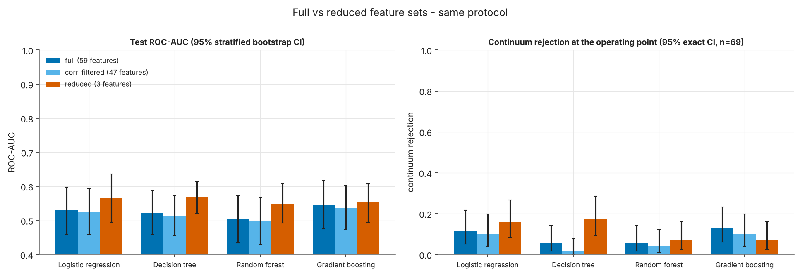</p>
<p align="center"><em>Figure 12. Full vs reduced feature sets with the same protocol. Feature rankings are fragile here and show association, not cause.</em></p>

---

## 8. Why is performance near chance? (checked)

`src/sanity_audit.py` found **no implementation problem**: labels and the positive-class column are aligned, every metric recomputes exactly with independent scikit-learn functions, shuffled-label controls give AUC 0.49-0.55, and the same pipeline reaches validation AUC 0.907 / 0.923 on a task that really has a difference. Cross-validation on train + validation (393 continuum events, no test data) gives out-of-fold AUC 0.549 [0.519, 0.578] (logistic) and 0.496 [0.467, 0.525] (boosting). **No physical separation is claimed.** Details: `reports/report.md`, section 5.

---

## 9. Demo app

```bash
streamlit run app.py
```

Upload a CSV with the 59 feature columns (no `type` column is needed). The app scores each event with the saved best model and its frozen threshold, shows the saved held-out performance, lets you download the predictions, and rejects invalid files with a clear message.

---

## 10. Reproduce everything

```bash
python -m venv .venv && source .venv/bin/activate
pip install -r requirements.txt            # PDF export additionally needs `pandoc` and `weasyprint` (optional); the browser test needs `playwright install chromium`
cp /path/to/data_hep.csv data/raw/data_hep.csv
python -m src.run_all                      # full regeneration incl. verification, notebook, report, README tables (~20-30 min on 2 CPU cores)
python -m src.run_all --docs-only          # re-render report, README tables, notebook from saved results (~2 min)
python -m pytest -q                        # tests
streamlit run app.py                       # demo app
python -m src.predict --input features.csv --output scores.csv    # command-line inference
```

**Run the notebook:** open `notebooks/continuum_suppression.ipynb` in Jupyter (`jupyter lab`, then Restart & Run All), or run `jupyter nbconvert --to notebook --execute --inplace notebooks/continuum_suppression.ipynb`. The first cell finds the project root by itself (start Jupyter anywhere inside the project, or set `CONTINUUM_ROOT=/path/to/project`) and is safe to re-run. It needs the same Python environment as `requirements.txt` and the results already in `artifacts/`.

`src.run_all` runs: audit + SQLite + splits (`src.prepare`), EDA, training with validation-based tuning and threshold selection (`src.train`), evaluation (`src.evaluate`), split repeats, other-decays diagnostic, feature dictionary, verification (`src.verify`), the pipeline sanity audit (`src.sanity_audit`), the test-isolation check, pytest, the Streamlit browser test, then `src.docs` (README tables, report, viva guide, executed notebook, PDF) and `src.verify_docs`. Every generated document carries the configuration fingerprint; if the configuration or data change and results are not regenerated, the build stops with a "STALE RESULTS" error instead of reusing old numbers. Tested with Python 3.13 and scikit-learn 1.9.1.

---

## 11. Repository layout

```
configs/      experiment settings, label mapping, student details
src/          audit, database, splits, training, evaluation, checks, notebook builder, predict
notebooks/    executed notebook with plain-language comments
reports/      full report (PDF + Markdown), feature dictionary, viva guide, checklist
artifacts/    figures, metrics tables, saved models, predictions, logs
tests/        unit tests, notebook-setup tests, browser test for the app
templates/    templates that fill every number from the saved results
app.py        Streamlit demo
data/         raw CSV (not tracked) and generated SQLite database (not tracked)
```

---

## 12. Verification (what was and was not tested)

* `python -m src.verify` ran **31 automated checks**; all passed: True. They cover: CSV checksum; SQLite raw table identical to the CSV; SQL-derived roles/targets equal the pandas mapping; the `primary_events` view equals the modelling subset; only codes 1, 0, -1 in the experiment; no excluded row (codes 2-5) in any train/validation/test split and no type -1 row invented; stratified class proportions in every split and at least one continuum event in each; no label/index/identifier column in any predictor list or bundle; every saved bundle reproduces its saved validation and test scores (max absolute difference 3.3e-16); test metrics, signal efficiency, continuum rejection (explicit class denominators), exact intervals and thresholds recompute independently from saved scores; thresholds re-derive from validation scores only and meet the efficiency floor on validation; hyper-parameters equal the validation-AUC winners; full / correlation-filtered / reduced comparisons used identical search budgets, seed and rules; inference works, uses the frozen threshold and rejects missing, non-numeric, missing-value and infinite inputs.
* **Test-set isolation check:** test rows' labels and feature values were deliberately scrambled, then feature reduction, tuning of single_cut, logreg, tree, boosting and threshold selection were re-run from scratch; all selected features, hyper-parameters, thresholds and validation scores were identical (True), so these choices do not read test data.
* `pytest`: 16 passed, 0 failed.
* **Streamlit upload flow** (real browser via Playwright against a locally started app that loads the saved model and frozen threshold): a valid CSV *without* the `type` or index columns was uploaded and scored (True); the downloaded predictions file matched the saved pipeline's scores and used the frozen threshold (True / True); a CSV that also contains `type` was scored with that column ignored (True); invalid CSVs were rejected with clear messages: missing feature column (True), missing value (True), non-numeric value (True). Inference never needs the true label.
* **Pipeline sanity audit** (`src.sanity_audit`, no new fitting on test data): label alignment and positive-class column (True); all reported metrics recomputed with independent scikit-learn functions, max difference 2.2e-16 (True); negative control (shuffled training labels) gives validation AUC 0.49-0.55; positive control (a learnable task through the same code) gives validation AUC 0.907 / 0.923; pooled train+validation 5-fold CV is reported in section 5. Overall: no implementation problem found (True).
* **Notebook:** executed from a fresh kernel with all outputs cleared first; every code cell has an execution count, there are zero error cells, and the setup cell was tested from five different start directories, re-run twice (no repeated directory changes, no duplicate `sys.path` entries), and outside the project (clear error; `CONTINUUM_ROOT` override).
* **Full retraining:** this whole analysis (preprocessing, splits, feature reduction, tuning, thresholds, evaluation, repeats) was re-run from the raw CSV for the corrected task; no fitted model, threshold or selection from the earlier `type == 1` versus all-others task was reused.
* **Not tested:** other operating systems or Python versions; the documents on a machine without pandoc/weasyprint; independent checking of the feature definitions against basf2 source code; the instructor's mapping itself (it cannot be verified from the data files).

---

## 13. Limitations

1. The mapping is instructor-provided and unverifiable from the data; only type 0 continuum rows exist (no type -1).
2. Only 69 continuum events in the test set (322 train, 71 validation): wide intervals and noisy validation-based choices.
3. No physical event identifier, so **event-level leakage cannot be ruled out**; simulated data with unverified generation details; SVM and neural networks were not attempted (the assignment lists SVM *or* gradient boosting; no single model is mandatory).
4. Test-set exposure: The held-out test metrics of this corrected run were inspected while developing and debugging the reporting and the score-file precision fix. No model, hyper-parameter, feature set or threshold was changed in response to test results (they are fixed by validation data: see the isolation check). An earlier, different task (type 1 vs all other codes) used a different split of a different subset; its rows overlap with the current rows, so the current test rows are not strictly untouched by earlier work.
5. Feature importance is associational, not causal.

An earlier `type == 1` vs all-other-codes analysis is a different task and is kept only as a historical record (`reports/historical_type1_vs_all_others.md`).

---

<div align="center">

**IDC409 - Introduction to Data Science and AI  |  IISER Mohali**
Daman Kumar (MS23031)  &  Pulkit (MS23099)

</div>
