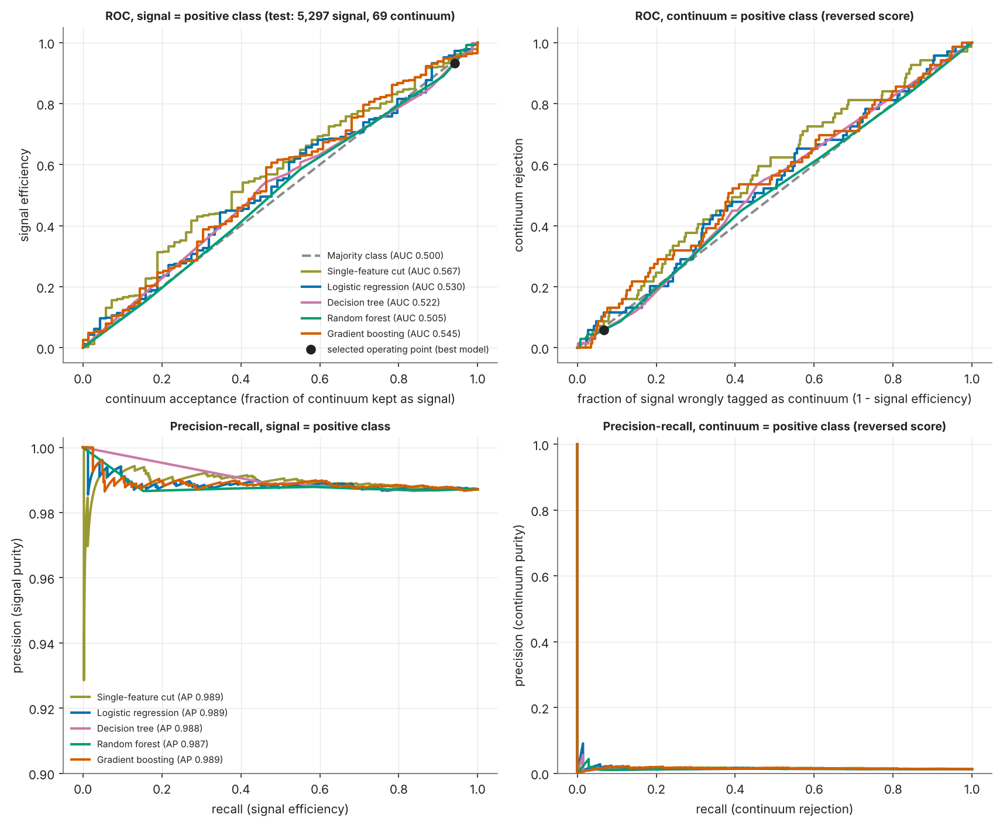
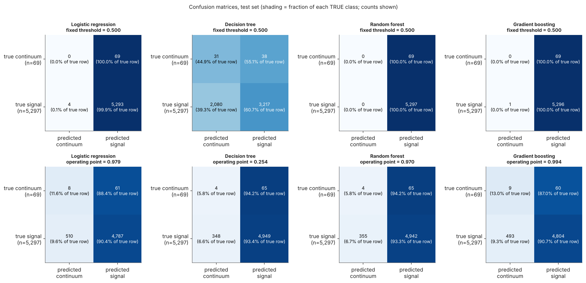

<!-- GENERATED by `python -m src.docs` from templates/README.md.tpl and the saved results of the current run (config fingerprint 4d55652eba8e68384e84f9b45973034903f7c4fb1abdab57660c062c084d99c4). Edit the template, not this file. -->
# Signal vs continuum classification with Belle II event-shape features

**IDC409 - Introduction to Data Science and AI (Project 1) - IISER Mohali.** Student: Daman Kumar (MS23031).

**Question.** How well can 59 Belle II event-shape features separate **signal** (`type = +1`) from **continuum background** (`type = 0` or `-1`), which classifier is best, and how much can the feature set be reduced?

> **Label mapping.** The code meanings come from the instructor's clarification relayed by the student (type +1 = signal; type 0 or -1 = continuum; codes 2-5 = other decays). It cannot be verified from the data files. Codes 2-5 are neither category, so I excluded them from this experiment - an *analysis decision*, not an instructor instruction. The CSV contains **35,303 signal, 462 continuum (all type 0) and 0 type -1 rows**; none were invented. The sample is 98.7% signal, so accuracy alone is misleading (predict-all-signal scores 0.987).

## Main results (held-out test set: 5,297 signal, 69 continuum events)

The validation-selected model (Random forest) has test ROC-AUC 0.505 (close to chance); its 95% interval 0.434-0.573 includes 0.5 (chance). The highest test AUC of any model is 0.567 (Single-feature cut, interval 0.504-0.630, which excludes 0.5 only barely; it was not the validation choice). Models whose AUC interval includes 0.5: Logistic regression, Decision tree, Random forest, Gradient boosting. On the instructor-provided mapping, at the validation-chosen operating point (signal efficiency floor 90%) the validation-selected model keeps 93.3% of true signal and rejects 5.8% of true continuum on the test set (only 69 continuum events; 95% exact interval 1.6%, 14.2%). For comparison, a score with no discrimination would reject about 6.7% at this efficiency.

**Flag for the instructor.** Under the instructor-provided mapping the type-0 events (the only continuum rows in the file; 0 type -1 rows exist) are, in these 59 features, nearly the same as the signal events: the best single feature (`thrustOm`) reaches an AUC of only 0.562 on the training rows, and no model separates the classes well. Physically, continuum (light-quark/charm) events are expected to be more jet-like (higher R2 and thrust, cosTBTO peaked at 1) than B-pair signal events; the type-0 events show the *signal-like* pattern instead (figure 3 and 4). This report does not change the mapping, but the data do not show the separation that a signal-versus-continuum task normally has, so it would be worth confirming with the instructor that code 0 really is continuum and that no type -1 data were meant to be included.

**Table A - required metrics at the validation-selected operating point** (maximise continuum rejection subject to signal efficiency >= 90% on validation; the 90% floor is an analysis choice). ROC-AUC is threshold-independent.

| Model | Accuracy | Precision (signal) | Recall (signal) | F1 (signal) | ROC-AUC [95% CI] | Features used | Threshold | Final fit (s) |
|---|---|---|---|---|---|---|---|---|
| Majority class | 0.987 | 0.987 | 1.0 | 0.994 | 0.500 [0.500, 0.500] | 0 | 1.0 | 0.0 |
| Single-feature cut | 0.899 | 0.988 | 0.909 | 0.947 | 0.567 [0.504, 0.630] | 1 (thrustOm; 59 examined) | 0.001 | 0.5 |
| Logistic regression | 0.894 | 0.987 | 0.904 | 0.944 | 0.530 [0.460, 0.598] | 59 | 0.979 | 0.1 |
| Decision tree | 0.923 | 0.987 | 0.934 | 0.96 | 0.522 [0.459, 0.588] | 59 | 0.254 | 1.2 |
| Random forest | 0.922 | 0.987 | 0.933 | 0.959 | 0.505 [0.434, 0.573] | 59 | 0.97 | 14.1 |
| Gradient boosting (HistGB) | 0.897 | 0.988 | 0.907 | 0.946 | 0.545 [0.475, 0.617] | 59 | 0.994 | 11.7 |


**Table B - signal efficiency and continuum rejection** (exact 95% intervals; continuum denominator = 69):

| Model | Signal efficiency [95% exact CI], n=5,297 | Continuum rejection [95% exact CI], n=69 | Continuum acceptance | Balanced accuracy | Macro-F1 |
|---|---|---|---|---|---|
| Majority class | 100.0% [99.9%, 100.0%] | 0.0% [0.0%, 5.2%] | 100.0% | 0.5 | 0.497 |
| Single-feature cut | 90.9% [90.1%, 91.6%] | 13.0% [6.1%, 23.3%] | 87.0% | 0.52 | 0.489 |
| Logistic regression | 90.4% [89.5%, 91.2%] | 11.6% [5.1%, 21.6%] | 88.4% | 0.51 | 0.485 |
| Decision tree | 93.4% [92.7%, 94.1%] | 5.8% [1.6%, 14.2%] | 94.2% | 0.496 | 0.489 |
| Random forest | 93.3% [92.6%, 94.0%] | 5.8% [1.6%, 14.2%] | 94.2% | 0.495 | 0.489 |
| Gradient boosting (HistGB) | 90.7% [89.9%, 91.5%] | 13.0% [6.1%, 23.3%] | 87.0% | 0.519 | 0.489 |


Results at the fixed threshold 0.5, per-class metrics, class-weighting comparison and the full/reduced comparison are in `artifacts/metrics/results_tables.md` and `reports/report.md`. With the paired stratified bootstrap, the AUC difference between the selected model and the following models has an interval that includes zero, so no clear difference is established on this test set: Single-feature cut, Logistic regression, Decision tree, Gradient boosting.

**Feature reduction** (59 -> 47 -> 3 features, same protocol):

| Model | Feature set | Features | ROC-AUC | AUC diff vs full [95% paired CI] | Signal eff. | Continuum rej. (n=69) | Balanced acc. |
|---|---|---|---|---|---|---|---|
| Logistic regression | full | 59 | 0.53 | - | 90.4% | 11.6% | 0.51 |
| Logistic regression | corr_filtered | 47 | 0.526 | -0.0030 [-0.0201, +0.0140] | 90.0% | 10.1% | 0.501 |
| Logistic regression | reduced | 3 | 0.565 | +0.0360 [-0.0307, +0.1029] | 89.6% | 15.9% | 0.528 |
| Decision tree | full | 59 | 0.522 | - | 93.4% | 5.8% | 0.496 |
| Decision tree | corr_filtered | 47 | 0.513 | -0.0084 [-0.0737, +0.0500] | 96.0% | 1.4% | 0.487 |
| Decision tree | reduced | 3 | 0.568 | +0.0444 [-0.0308, +0.1240] | 90.4% | 17.4% | 0.539 |
| Random forest | full | 59 | 0.505 | - | 93.3% | 5.8% | 0.495 |
| Random forest | corr_filtered | 47 | 0.497 | -0.0072 [-0.0872, +0.0683] | 93.6% | 4.3% | 0.49 |
| Random forest | reduced | 3 | 0.548 | +0.0428 [-0.0275, +0.1121] | 91.1% | 7.2% | 0.491 |
| Gradient boosting (HistGB) | full | 59 | 0.545 | - | 90.7% | 13.0% | 0.519 |
| Gradient boosting (HistGB) | corr_filtered | 47 | 0.537 | -0.0094 [-0.0699, +0.0484] | 91.4% | 10.1% | 0.508 |
| Gradient boosting (HistGB) | reduced | 3 | 0.553 | +0.0063 [-0.0759, +0.0884] | 90.7% | 7.2% | 0.49 |





## Data

`data/raw/data_hep.csv` - 70,606 rows, 59 numeric features, an unnamed index-like column, and `type` (counts 0: 462, 1: 35,303, 2: 23,333, 3: 8,172, 4: 1,879, 5: 1,457). SHA-256 `fadaeb5a20a7809658f760eb4b49feef3ee89c7823d1a215356d40e20266cf67`. Provided by the course as the Belle II sample; provenance not independently verified. **The CSV is git-ignored** (80 MB; permission to redistribute is not established): place your copy at `data/raw/data_hep.csv`. The index-like column repeats values and its range depends on the label; its origin is undocumented, so it is excluded from predictors as a leakage risk. Primary experiment = `raw["type"].isin([1, 0, -1])`; excluded rows (type 2: 23,333; type 3: 8,172; type 4: 1,879; type 5: 1,457) and original row identifiers are recorded in `artifacts/metrics/split_assignments.csv`.

## Repository layout

```
configs/experiment.json   seed, student details, label mapping, split, tuning grids, operating-point rule
templates/                report / README / viva-guide templates (all numbers are filled from saved results)
src/                      prepare - eda - train - evaluate - repeats - other_decays - feature_dictionary - verify - isolation - docs - predict
notebooks/                continuum_suppression.ipynb (generated and executed by src.docs)
reports/                  report.md / report.pdf, viva_guide.md, feature_dictionary.md, requirements_checklist.md, historical_type1_vs_all_others.md
artifacts/figures|metrics|models|predictions|logs   all generated outputs (models: joblib bundles with features + frozen threshold)
tests/  app.py            pytest suite; Streamlit demo (+ tests/e2e_streamlit.py browser upload test)
data/hep.sqlite           generated (git-ignored): raw table, working table, mapping table, primary_events view, metadata
```

## Reproduce everything

```bash
python -m venv .venv && source .venv/bin/activate
pip install -r requirements.txt            # PDF export additionally needs `pandoc` and `weasyprint` (optional); the browser test needs `playwright install chromium`
cp /path/to/data_hep.csv data/raw/data_hep.csv
python -m src.run_all                      # full regeneration incl. verification, notebook, report, README tables (~20-30 min on 2 CPU cores)
python -m src.run_all --docs-only          # re-render report, README tables, notebook from saved results (~2 min)
python -m pytest -q                        # tests
streamlit run app.py                       # optional demo (uses the saved best model and its frozen threshold)
python -m src.predict --input features.csv --output scores.csv    # CLI inference
```

`src.run_all` runs: audit + SQLite + splits (`src.prepare`), EDA, training with validation-based tuning and threshold selection (`src.train`), evaluation (`src.evaluate`), split repeats, other-decays diagnostic, feature dictionary, verification (`src.verify`), the test-isolation check, pytest, the Streamlit browser test, then `src.docs` (README tables, report, viva guide, executed notebook, PDF) and `src.verify_docs`. Every generated document carries the configuration fingerprint; if the configuration or data change and results are not regenerated, `src.docs` and `src.verify` stop with a "STALE RESULTS" error instead of reusing old numbers. Student details come from `configs/experiment.json` and are preserved. Tested with Python 3.13, scikit-learn 1.9.1.

## Method in brief

SQLite stores the untouched raw table; role, target and split columns are filled with SQL `UPDATE`, and `primary_events` is the exact modelling subset. Stratified 70/15/15 split (seed 42) with duplicate grouping. Scalers and class weights are fitted on training rows only; validation and test data are never resampled or weighted. Hyper-parameters and the model are chosen by validation ROC-AUC; the operating threshold maximises validation continuum rejection subject to signal efficiency >= 90%; the test set is scored once. Feature reduction = correlation filter (|Spearman| >= 0.95) + validation permutation importance + smallest k reaching 99.5% of full validation AUC.

## Verification (what was and was not tested)

* `python -m src.verify` ran **31 automated checks**; all passed: True. They cover: CSV checksum; SQLite raw table identical to the CSV; SQL-derived roles/targets equal the pandas mapping; the `primary_events` view equals the modelling subset; only codes 1, 0, -1 in the experiment; no excluded row (codes 2-5) in any train/validation/test split and no type -1 row invented; stratified class proportions in every split and at least one continuum event in each; no label/index/identifier column in any predictor list or bundle; every saved bundle reproduces its saved validation and test scores (max absolute difference 3.3e-16); test metrics, signal efficiency, continuum rejection (explicit class denominators), exact intervals and thresholds recompute independently from saved scores; thresholds re-derive from validation scores only and meet the efficiency floor on validation; hyper-parameters equal the validation-AUC winners; full / correlation-filtered / reduced comparisons used identical search budgets, seed and rules; inference works, uses the frozen threshold and rejects missing, non-numeric, missing-value and infinite inputs.
* **Test-set isolation check:** test rows' labels and feature values were deliberately scrambled, then feature reduction, tuning of single_cut, logreg, tree, boosting and threshold selection were re-run from scratch; all selected features, hyper-parameters, thresholds and validation scores were identical (True), so these choices do not read test data.
* `pytest`: 10 passed, 0 failed.
* **Streamlit upload flow** (real browser via Playwright against a locally started app that loads the saved model and threshold): valid CSV scored (True); CSV missing a feature column rejected with a clear message (True); missing value rejected (True); non-numeric value rejected (True).
* **Full retraining:** this whole analysis (preprocessing, splits, feature reduction, tuning, thresholds, evaluation, repeats) was re-run from the raw CSV for the corrected task; no fitted model, threshold or selection from the earlier `type == 1` versus all-others task was reused.
* **Not tested:** other operating systems or Python versions; the documents on a machine without pandoc/weasyprint; independent checking of the feature definitions against basf2 source code; the instructor's mapping itself (it cannot be verified from the data files).

## Limitations

1. The mapping is instructor-provided and unverifiable from the data; only type 0 continuum rows exist (no type -1).
2. Only 69 continuum events in the test set (322 train, 71 validation): wide intervals and noisy validation-based choices.
3. No physical event identifier; simulated data with unverified generation details; SVM/neural networks not attempted.
4. Feature importance is associational, not causal.

An earlier `type == 1` vs all-other-codes analysis is a different task and is kept only as a historical record (`reports/historical_type1_vs_all_others.md`). Reference for project organisation: https://github.com/winteriscoming07/DS_leaf (structure only; no code or text reused).
