<!-- GENERATED by `python -m src.docs` from templates/report.md.tpl and the saved results of the current run (config fingerprint 4d55652eba8e68384e84f9b45973034903f7c4fb1abdab57660c062c084d99c4). Do not edit by hand. -->

# Summary

**Task.** Classify Belle II events as **signal** (`type = +1`) or **continuum background** (`type = 0` or `-1`) from 59 event-shape features. The meaning of the codes comes from the **instructor's clarification, relayed by the student**: type +1 is signal, type 0 or -1 is continuum, and codes 2, 3, 4, 5 are other decays. It could not be verified from the data files. Codes 2-5 are neither of the two specified categories, so I excluded them from this experiment; that exclusion is **my analysis decision, not an instruction from the instructor**.

**Data actually used.** Of 70,606 rows, 35,765 have type in {1, 0, -1}: **35,303 signal and 462 continuum** (type 0: 462; **0 rows of type -1 exist** and none were created). The sample is 98.7% signal, so a rule that calls every event signal is 0.987 accurate and rejects no continuum. 34,841 rows (type 2: 23,333; type 3: 8,172; type 4: 1,879; type 5: 1,457) were excluded. The held-out test set has **5,297 signal and only 69 continuum events**, which limits how precisely continuum rejection can be measured.

**Models.** Four learned classifiers (logistic regression, decision tree, random forest, gradient boosting) and two baselines (majority class; a single-feature cut using one feature), the learned classifiers tuned on validation data, with training-only class weighting compared fairly.

**Result.** The validation-selected model (Random forest) has test ROC-AUC 0.505 (close to chance); its 95% interval 0.434-0.573 includes 0.5 (chance). The highest test AUC of any model is 0.567 (Single-feature cut, interval 0.504-0.630, which excludes 0.5 only barely; it was not the validation choice). Models whose AUC interval includes 0.5: Logistic regression, Decision tree, Random forest, Gradient boosting. On the instructor-provided mapping, at the validation-chosen operating point (signal efficiency floor 90%) the validation-selected model keeps 93.3% of true signal and rejects 5.8% of true continuum on the test set (only 69 continuum events; 95% exact interval 1.6%, 14.2%). For comparison, a score with no discrimination would reject about 6.7% at this efficiency. With the paired stratified bootstrap, the AUC difference between the selected model and the following models has an interval that includes zero, so no clear difference is established on this test set: Single-feature cut, Logistic regression, Decision tree, Gradient boosting.

**Flag for the instructor.** Under the instructor-provided mapping the type-0 events (the only continuum rows in the file; 0 type -1 rows exist) are, in these 59 features, nearly the same as the signal events: the best single feature (`thrustOm`) reaches an AUC of only 0.562 on the training rows, and no model separates the classes well. Physically, continuum (light-quark/charm) events are expected to be more jet-like (higher R2 and thrust, cosTBTO peaked at 1) than B-pair signal events; the type-0 events show the *signal-like* pattern instead (figure 3 and 4). This report does not change the mapping, but the data do not show the separation that a signal-versus-continuum task normally has, so it would be worth confirming with the instructor that code 0 really is continuum and that no type -1 data were meant to be included.

*Operating point.* The "operating point" is the score threshold chosen on **validation** data to maximise continuum rejection subject to a signal efficiency of at least 90%. The 90% figure is an analysis choice, not an instructor requirement. The threshold was frozen before the test set was scored, and the test efficiency and rejection are reported as they came out. Results at the fixed threshold 0.5 are given separately. ROC-AUC does not depend on the threshold: it uses the continuous scores of the same test rows, so it is the same at every operating point.

# 1. Data, label mapping and selection

| Item | Verified fact |
|---|---|
| File | `data_hep.csv`, SHA-256 `fadaeb5a20a7809658f760eb4b49feef3ee89c7823d1a215356d40e20266cf67` (never modified) |
| Shape | 70,606 rows, 59 numeric features, an unnamed index-like column, and `type` |
| `type` counts in the file | 0: 462, 1: 35,303, 2: 23,333, 3: 8,172, 4: 1,879, 5: 1,457 |
| Primary experiment | `selected = raw.loc[raw["type"].isin([1, 0, -1])]`, `y = (selected["type"] == 1)`: 35,765 rows = 35,303 signal + 462 continuum |
| Excluded (analysis decision) | 34,841 rows (type 2: 23,333; type 3: 8,172; type 4: 1,879; type 5: 1,457); counts and original row identifiers are recorded in `artifacts/metrics/split_assignments.csv` |
| Quality | no missing or infinite values, no constant columns, no duplicate feature vectors, no conflicting duplicates, no common sentinel values |
| Provenance | supplied as the course's Belle II sample ("simulated/analysis-level Belle II MC" in the project PDF). The generation procedure was not independently verified. |

**Label mapping and its source.** Clarification from the instructor, relayed by the student: type = +1 is signal; type = 0 or -1 is continuum background; codes 2, 3, 4, 5 represent other decays. The status is: *INSTRUCTOR-PROVIDED (relayed by the student on 30 Oct 2026); not verifiable from the data files themselves*. The exclusion of codes 2-5 is ANALYSIS DECISION (not an instruction from the instructor): codes 2-5 are neither of the two specified categories, so they are excluded from the primary signal-versus-continuum experiment.

**Index column.** The unnamed first column repeats 1,766 values across the file, is unique only within each type code, and its range depends on the code. That pattern resembles a running index from separate source files, but its origin is not documented, so I do not assert it. Because it is not a reliable event identifier and could encode the label, it is excluded from all predictors (together with `type` and all other identifiers). Original row identifiers (`row_id`, `csv_index`) are kept in the database and split manifest for traceability.

**Splits and class counts.** Stratified on the class, so every split keeps the class proportions; duplicates are grouped (none exist), and no excluded row appears in any split.

| Split | Signal | Continuum | Total | Signal fraction |
|---|---|---|---|---|
| train | 24,711 | 322 | 25,033 | 98.7% |
| validation | 5,295 | 71 | 5,366 | 98.7% |
| test | 5,297 | 69 | 5,366 | 98.7% |
| total (primary experiment) | 35,303 | 462 | 35,765 | 98.7% |

# 2. Method

* **Storage.** NumPy/pandas for analysis. SQLite holds the untouched raw table, a working table with `role`, `in_primary`, `target` and `split` columns filled by SQL `UPDATE`, a `type_mapping` table, and a `primary_events` view that is exactly the modelling subset; everything was read back and verified against pandas.
* **Leakage control.** `type`, the index column and all identifiers are never predictors. Scaling and class weighting are fitted on training rows only. Hyper-parameters (including whether to use class weighting) are chosen by validation ROC-AUC; the operating threshold uses validation data only; validation and test data are never resampled, weighted or balanced; the test set is only scored.
* **Models.** Baselines: majority class (0 features; always predicts signal) and a single-feature cut that uses **one** feature, `thrustOm`, picked as the best of 59 candidates by training AUC, with the cut maximising training *balanced* accuracy. Learned: logistic regression, decision tree, random forest, HistGradientBoosting; bounded random/grid searches (8-12 configurations).
* **Class weighting.** `class_weight` (training-only) is a tuned option for every learned model; the validation comparison is in Table F.
* **Metrics.** Class 1 = signal. *Signal efficiency* = fraction of true signal retained; *continuum rejection* = fraction of true continuum rejected; *continuum acceptance* = fraction of true continuum wrongly kept = 1 - rejection. Also accuracy, signal precision/recall/F1, balanced accuracy, macro-F1 and per-class precision/recall/F1.
* **Uncertainty.** Efficiency and rejection use exact (Clopper-Pearson) 95% intervals with their actual denominators (5,297 signal, 69 continuum). ROC-AUC uses a stratified bootstrap (signal and continuum resampled separately, 1,000 resamples). Model comparisons use a paired stratified bootstrap on the shared test rows. All of these treat the fitted models as fixed and cannot capture training-set variability, which is large with 322 training continuum events; 4 further re-splits with frozen hyper-parameters give an extra view.
* **Feature reduction.** (1) correlation filter (|Spearman| >= 0.95 on training rows, keep the more separating feature): 59 -> 47; (2) rank by permutation importance of a class-weighted gradient-boosting model on validation data; (3) smallest k with val AUC >= 0.995 x full-feature val AUC: k = 3. All learned models were re-tuned and evaluated with the same protocol.

# 3. Exploratory analysis (training data only for decisions)

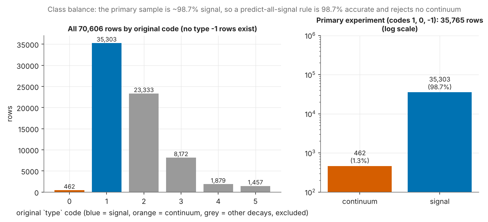{width=95%}

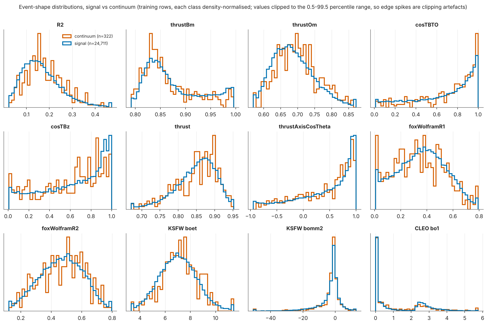{width=100%}

The signal and continuum distributions overlap almost completely for every variable shown; the best single feature (`thrustOm`) has a training AUC of only 0.562. 17 feature pairs have |r| >= 0.9 (KSFW moments from B primary daughters and from final-state particles correlate up to 1.0). Exact zeros occur only in CLEO-cone features and were kept. These plots show association with the labels, not causes.

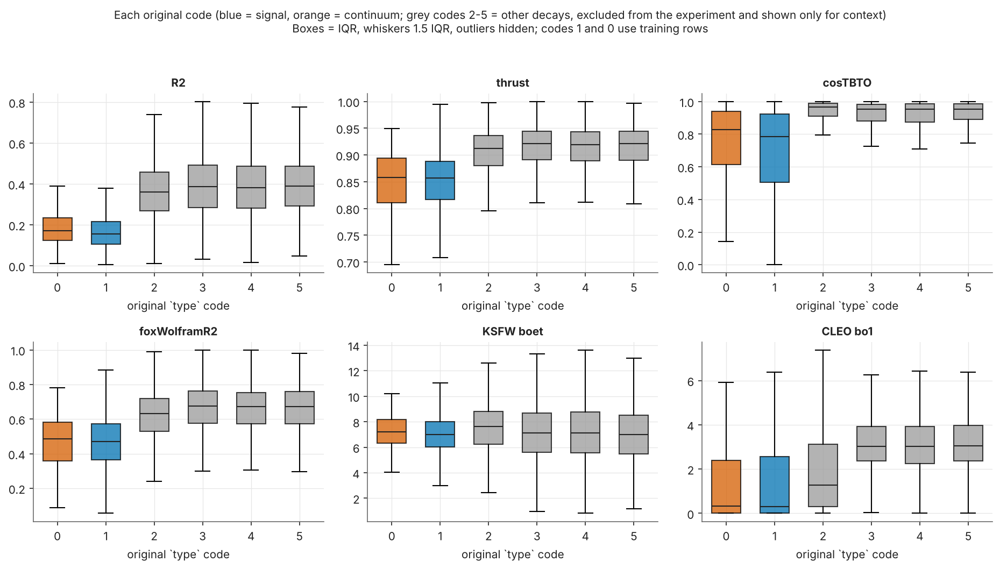{width=100%}

# 4. Results (held-out test set: 5,297 signal, 69 continuum)

**Table A - required metrics at the validation-selected operating point** (signal is the positive class; ROC-AUC with 95% stratified-bootstrap CI).

| Model | Accuracy | Precision (signal) | Recall (signal) | F1 (signal) | ROC-AUC [95% CI] | Features used | Threshold | Final fit (s) |
|---|---|---|---|---|---|---|---|---|
| Majority class | 0.987 | 0.987 | 1.0 | 0.994 | 0.500 [0.500, 0.500] | 0 | 1.0 | 0.0 |
| Single-feature cut | 0.899 | 0.988 | 0.909 | 0.947 | 0.567 [0.504, 0.630] | 1 (thrustOm; 59 examined) | 0.001 | 0.5 |
| Logistic regression | 0.894 | 0.987 | 0.904 | 0.944 | 0.530 [0.460, 0.598] | 59 | 0.979 | 0.1 |
| Decision tree | 0.923 | 0.987 | 0.934 | 0.96 | 0.522 [0.459, 0.588] | 59 | 0.254 | 1.2 |
| Random forest | 0.922 | 0.987 | 0.933 | 0.959 | 0.505 [0.434, 0.573] | 59 | 0.97 | 14.1 |
| Gradient boosting (HistGB) | 0.897 | 0.988 | 0.907 | 0.946 | 0.545 [0.475, 0.617] | 59 | 0.994 | 11.7 |

The majority baseline reaches accuracy 0.987 but balanced accuracy 0.500: accuracy is not informative here, which is why efficiency, rejection and balanced accuracy are reported.

**Table B - signal efficiency and continuum rejection at the operating point** (exact 95% intervals; the continuum denominator is 69 events).

| Model | Signal efficiency [95% exact CI], n=5,297 | Continuum rejection [95% exact CI], n=69 | Continuum acceptance | Balanced accuracy | Macro-F1 |
|---|---|---|---|---|---|
| Majority class | 100.0% [99.9%, 100.0%] | 0.0% [0.0%, 5.2%] | 100.0% | 0.5 | 0.497 |
| Single-feature cut | 90.9% [90.1%, 91.6%] | 13.0% [6.1%, 23.3%] | 87.0% | 0.52 | 0.489 |
| Logistic regression | 90.4% [89.5%, 91.2%] | 11.6% [5.1%, 21.6%] | 88.4% | 0.51 | 0.485 |
| Decision tree | 93.4% [92.7%, 94.1%] | 5.8% [1.6%, 14.2%] | 94.2% | 0.496 | 0.489 |
| Random forest | 93.3% [92.6%, 94.0%] | 5.8% [1.6%, 14.2%] | 94.2% | 0.495 | 0.489 |
| Gradient boosting (HistGB) | 90.7% [89.9%, 91.5%] | 13.0% [6.1%, 23.3%] | 87.0% | 0.519 | 0.489 |

**Table C - the same models at the fixed threshold 0.5.** ROC-AUC is the same as in Table A because the scores and test rows are unchanged.

| Model | Accuracy | Precision (signal) | Recall (signal) | F1 (signal) | ROC-AUC | Signal efficiency | Continuum rejection (n=69) | Balanced accuracy | Macro-F1 |
|---|---|---|---|---|---|---|---|---|---|
| Majority class | 0.987 | 0.987 | 1.0 | 0.994 | 0.5 | 100.0% | 0.0% | 0.5 | 0.497 |
| Single-feature cut | 0.428 | 0.991 | 0.425 | 0.595 | 0.567 | 42.5% | 71.0% | 0.567 | 0.313 |
| Logistic regression | 0.986 | 0.987 | 0.999 | 0.993 | 0.53 | 99.9% | 0.0% | 0.5 | 0.497 |
| Decision tree | 0.605 | 0.988 | 0.607 | 0.752 | 0.522 | 60.7% | 44.9% | 0.528 | 0.39 |
| Random forest | 0.987 | 0.987 | 1.0 | 0.994 | 0.505 | 100.0% | 0.0% | 0.5 | 0.497 |
| Gradient boosting (HistGB) | 0.987 | 0.987 | 1.0 | 0.993 | 0.545 | 100.0% | 0.0% | 0.5 | 0.497 |

**Table D - per-class precision, recall and F1 at the operating point.**

| Model | Signal P | Signal R | Signal F1 | Continuum P | Continuum R | Continuum F1 |
|---|---|---|---|---|---|---|
| Majority class | 0.987 | 1.0 | 0.994 | 0.0 | 0.0 | 0.0 |
| Single-feature cut | 0.988 | 0.909 | 0.947 | 0.018 | 0.13 | 0.032 |
| Logistic regression | 0.987 | 0.904 | 0.944 | 0.015 | 0.116 | 0.027 |
| Decision tree | 0.987 | 0.934 | 0.96 | 0.011 | 0.058 | 0.019 |
| Random forest | 0.987 | 0.933 | 0.959 | 0.011 | 0.058 | 0.019 |
| Gradient boosting (HistGB) | 0.988 | 0.907 | 0.946 | 0.018 | 0.13 | 0.032 |

**Selected model.** Random forest (59 features) was chosen by validation AUC (0.562) (the highest test AUC belongs to single_cut|full, but model selection used validation data only). At its operating point (threshold 0.970; validation efficiency 92.9%, validation rejection 16.9%) the test set gives signal efficiency 93.3% [92.6%, 94.0%] and continuum rejection 5.8% [1.6%, 14.2%] (acceptance 94.2%); confusion counts: 4942 signal kept, 355 signal lost, 4 continuum rejected, 65 continuum kept. The test values are not forced to equal the validation targets. At threshold 0.5: efficiency 100.0%, continuum rejection 0.0% [0.0%, 5.2%].

**Model comparison.** With the paired stratified bootstrap, the AUC difference between the selected model and the following models has an interval that includes zero, so no clear difference is established on this test set: Single-feature cut, Logistic regression, Decision tree, Gradient boosting.

| Comparison (same test rows) | AUC difference [95% paired stratified-bootstrap CI] | CI excludes 0 |
|---|---|---|
| forest minus majority | +0.0049 [-0.0659, +0.0732] | no |
| forest minus single_cut | -0.0620 [-0.1521, +0.0340] | no |
| forest minus logreg | -0.0247 [-0.1018, +0.0555] | no |
| forest minus tree | -0.0170 [-0.1004, +0.0637] | no |
| forest minus boosting | -0.0400 [-0.1120, +0.0307] | no |

Over 5 different splits (frozen hyper-parameters) the model ordering by AUC is not the same in every split (see table), so the ranking of models is not stable:

| Model | ROC-AUC mean +/- sd (5 splits) | Signal efficiency (mean) | Continuum rejection mean +/- sd [min, max] |
|---|---|---|---|
| Single-feature cut | 0.530 +/- 0.034 | 90.1% | 11.8% +/- 3.7% [7.2%, 17.1%] |
| Logistic regression | 0.534 +/- 0.034 | 90.3% | 10.4% +/- 3.8% [5.8%, 15.9%] |
| Decision tree | 0.526 +/- 0.042 | 92.4% | 6.4% +/- 1.6% [4.3%, 8.7%] |
| Random forest | 0.513 +/- 0.048 | 92.5% | 6.1% +/- 2.3% [4.3%, 10.0%] |
| Gradient boosting (HistGB) | 0.518 +/- 0.039 | 89.4% | 12.7% +/- 6.3% [2.9%, 20.3%] |

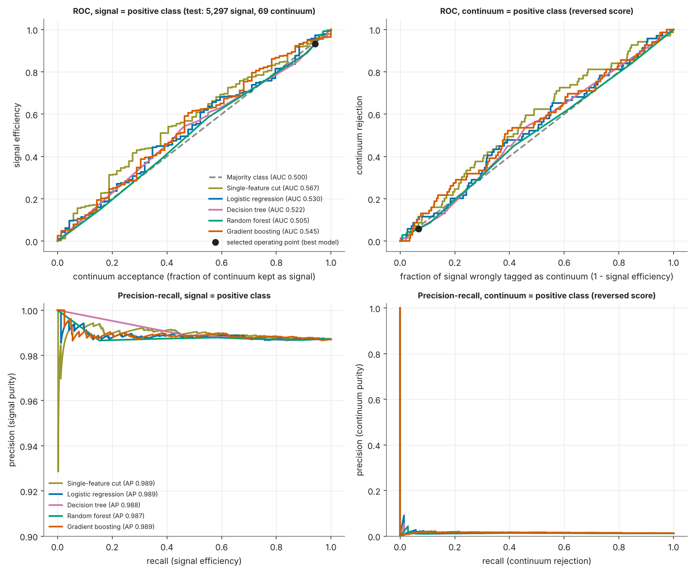{width=100%}

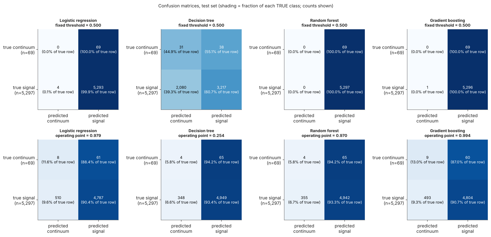{width=100%}

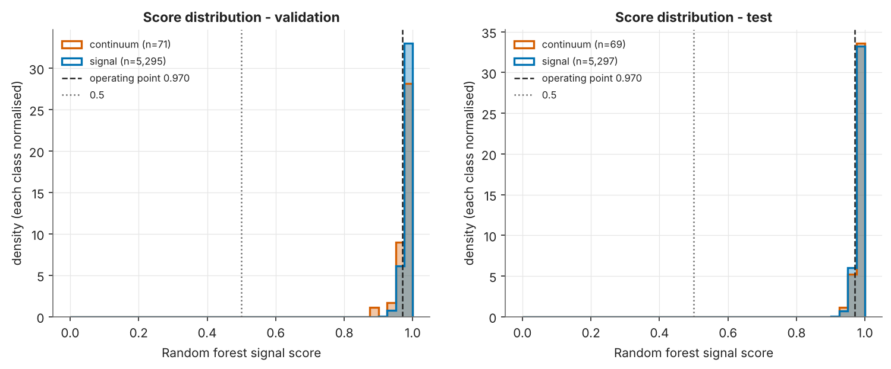{width=100%}

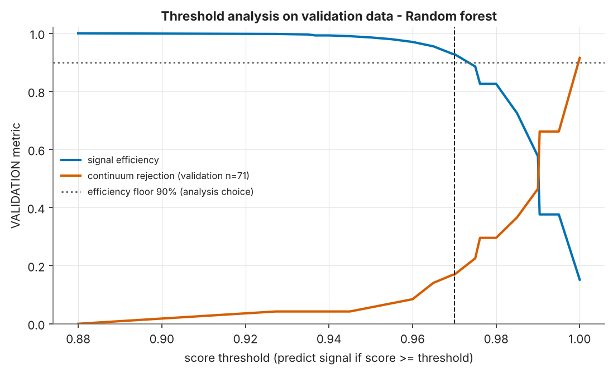{width=75%}

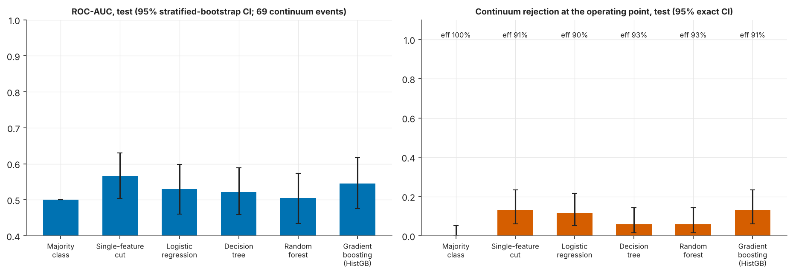{width=100%}

**Table F - training-only class weighting compared on validation data.**

| Model | best validation AUC, no weighting | best validation AUC, training-only class weighting | weighting chosen |
|---|---|---|---|
| Logistic regression | 0.505 | 0.505 | no |
| Decision tree | 0.518 | 0.543 | yes |
| Random forest | 0.508 | 0.562 | yes |
| Gradient boosting (HistGB) | 0.539 | 0.548 | yes |

**Other decays (out of scope).** For context only, the final model was also applied to the excluded rows of codes 2-5, which belong to no split and influenced nothing. They are not signal or continuum, so these fractions measure nothing about performance; they show only how the signal-vs-continuum score treats them (codes 0 and 1: held-out test rows).

| type code | role | rows scored | scored on | fraction accepted as signal |
|---|---|---|---|---|
| 0 | continuum | 69 | held-out test rows | 94.2% |
| 1 | signal | 5,297 | held-out test rows | 93.3% |
| 2 | other_decay (excluded, out of scope) | 23,333 | all rows of the excluded code | 93.8% |
| 3 | other_decay (excluded, out of scope) | 8,172 | all rows of the excluded code | 95.3% |
| 4 | other_decay (excluded, out of scope) | 1,879 | all rows of the excluded code | 95.3% |
| 5 | other_decay (excluded, out of scope) | 1,457 | all rows of the excluded code | 93.7% |

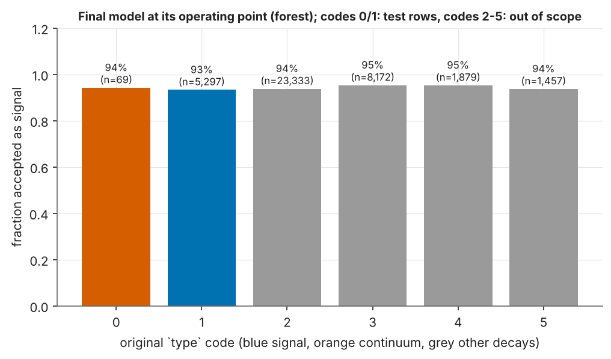{width=70%}

# 5. Feature reduction

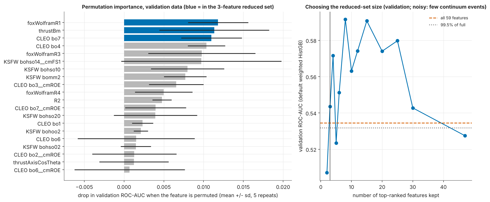{width=100%}

Reduced set (3 features): `foxWolframR1`, `thrustBm`, `CleoConeCS__bo7__bc`. `foxWolframR1` has the largest importance (0.012 validation-AUC drop when permuted); the next is `thrustBm` (0.011). With near-chance separation these rankings are fragile and should not be interpreted physically.

| Model | Feature set | Features | ROC-AUC | AUC diff vs full [95% paired CI] | Signal eff. | Continuum rej. (n=69) | Balanced acc. |
|---|---|---|---|---|---|---|---|
| Logistic regression | full | 59 | 0.53 | - | 90.4% | 11.6% | 0.51 |
| Logistic regression | corr_filtered | 47 | 0.526 | -0.0030 [-0.0201, +0.0140] | 90.0% | 10.1% | 0.501 |
| Logistic regression | reduced | 3 | 0.565 | +0.0360 [-0.0307, +0.1029] | 89.6% | 15.9% | 0.528 |
| Decision tree | full | 59 | 0.522 | - | 93.4% | 5.8% | 0.496 |
| Decision tree | corr_filtered | 47 | 0.513 | -0.0084 [-0.0737, +0.0500] | 96.0% | 1.4% | 0.487 |
| Decision tree | reduced | 3 | 0.568 | +0.0444 [-0.0308, +0.1240] | 90.4% | 17.4% | 0.539 |
| Random forest | full | 59 | 0.505 | - | 93.3% | 5.8% | 0.495 |
| Random forest | corr_filtered | 47 | 0.497 | -0.0072 [-0.0872, +0.0683] | 93.6% | 4.3% | 0.49 |
| Random forest | reduced | 3 | 0.548 | +0.0428 [-0.0275, +0.1121] | 91.1% | 7.2% | 0.491 |
| Gradient boosting (HistGB) | full | 59 | 0.545 | - | 90.7% | 13.0% | 0.519 |
| Gradient boosting (HistGB) | corr_filtered | 47 | 0.537 | -0.0094 [-0.0699, +0.0484] | 91.4% | 10.1% | 0.508 |
| Gradient boosting (HistGB) | reduced | 3 | 0.553 | +0.0063 [-0.0759, +0.0884] | 90.7% | 7.2% | 0.49 |

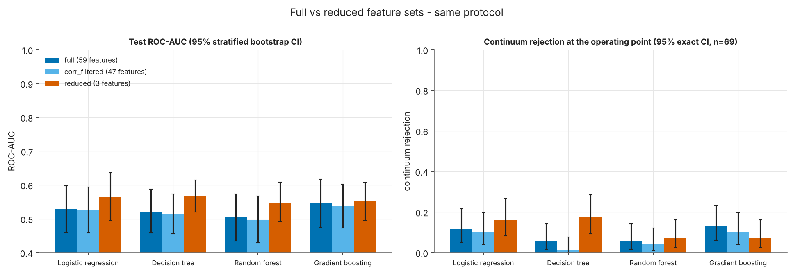{width=100%}

AUC change versus the full set - correlation-filtered (47 features): logistic regression -0.0030 (CI includes 0); decision tree -0.0084 (CI includes 0); random forest -0.0072 (CI includes 0); gradient boosting -0.0094 (CI includes 0). Reduced (3 features): logistic regression +0.0360 (CI includes 0); decision tree +0.0444 (CI includes 0); random forest +0.0428 (CI includes 0); gradient boosting +0.0063 (CI includes 0). The reduced list was chosen with a boosting model on noisy validation data, so differences for other models should not be over-read. Permutation importance describes what the fitted model uses; correlated features share importance; it carries no causal meaning.

# 6. How this differs from the earlier analysis

An earlier version of this project classified `type == 1` against **all** other codes, which put other decays (codes 2-5, 34,841 rows) into the negative class. Those results were not a signal-versus-continuum measurement and are **not** used anywhere above. They are kept only as a separate historical record (`reports/historical_type1_vs_all_others.md`) and must never be compared with the numbers in this report: the task, the class sizes (35,303 vs 462 instead of 35,303 vs 35,303) and the meaning of the negative class are all different.

# 7. Limitations

1. **Mapping provenance.** The code meanings are instructor-provided via the student and cannot be verified from the data. Only type 0 continuum rows exist; no type -1 rows are present.
2. **Very few continuum events:** 322 / 71 / 69 in train / validation / test. Intervals are wide, validation-based choices (model, reduced features, threshold) are noisy, and the results could change materially with another split (see the split-repeat table).
3. No physical event identifier exists; rows from the same event could in principle fall into different splits. Duplicate feature vectors were checked (none).
4. Bounded tuning budgets; SVM and neural networks were not attempted. Class weighting was compared; resampling was not used.
5. Simulated data; the generation details were not verified; the feature definitions come from Belle II documentation and variable names (the `__bc` suffix and KSFW indices were not independently checked).
6. Intervals treat the trained models as fixed and exclude training-set variability.

# 8. Reproducibility and verification (what was and was not tested)

`python -m src.run_all` regenerates, from the raw CSV: the audit, SQLite tables and splits; all models, predictions and metrics; feature reduction and figures; the split repeats and diagnostics; verification; the executed notebook; this report (and its PDF when pandoc and weasyprint are installed); and the result tables in the README. Every generated document carries the configuration fingerprint and the build stops with a "STALE RESULTS" error if results do not match the configuration.

* `python -m src.verify` ran **31 automated checks**; all passed: True. They cover: CSV checksum; SQLite raw table identical to the CSV; SQL-derived roles/targets equal the pandas mapping; the `primary_events` view equals the modelling subset; only codes 1, 0, -1 in the experiment; no excluded row (codes 2-5) in any train/validation/test split and no type -1 row invented; stratified class proportions in every split and at least one continuum event in each; no label/index/identifier column in any predictor list or bundle; every saved bundle reproduces its saved validation and test scores (max absolute difference 3.3e-16); test metrics, signal efficiency, continuum rejection (explicit class denominators), exact intervals and thresholds recompute independently from saved scores; thresholds re-derive from validation scores only and meet the efficiency floor on validation; hyper-parameters equal the validation-AUC winners; full / correlation-filtered / reduced comparisons used identical search budgets, seed and rules; inference works, uses the frozen threshold and rejects missing, non-numeric, missing-value and infinite inputs.
* **Test-set isolation check:** test rows' labels and feature values were deliberately scrambled, then feature reduction, tuning of single_cut, logreg, tree, boosting and threshold selection were re-run from scratch; all selected features, hyper-parameters, thresholds and validation scores were identical (True), so these choices do not read test data.
* `pytest`: 10 passed, 0 failed.
* **Streamlit upload flow** (real browser via Playwright against a locally started app that loads the saved model and threshold): valid CSV scored (True); CSV missing a feature column rejected with a clear message (True); missing value rejected (True); non-numeric value rejected (True).
* **Full retraining:** this whole analysis (preprocessing, splits, feature reduction, tuning, thresholds, evaluation, repeats) was re-run from the raw CSV for the corrected task; no fitted model, threshold or selection from the earlier `type == 1` versus all-others task was reused.
* **Not tested:** other operating systems or Python versions; the documents on a machine without pandoc/weasyprint; independent checking of the feature definitions against basf2 source code; the instructor's mapping itself (it cannot be verified from the data files).
